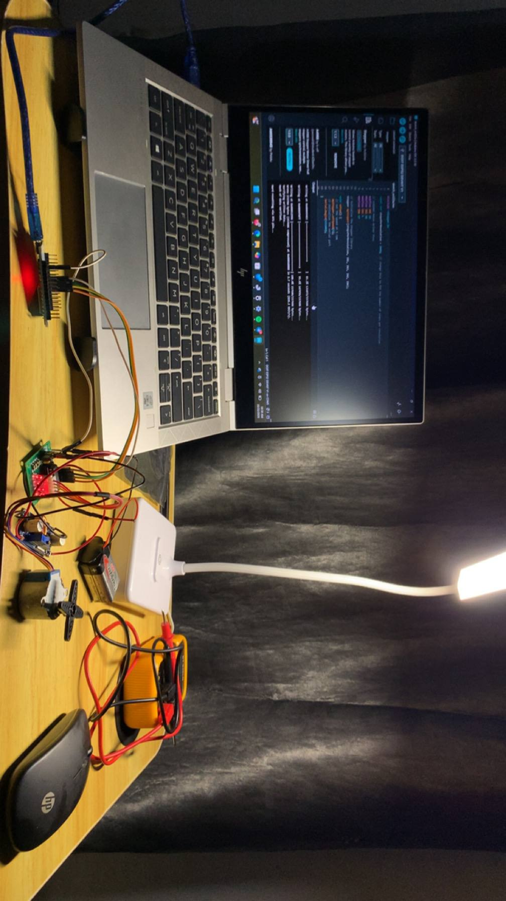
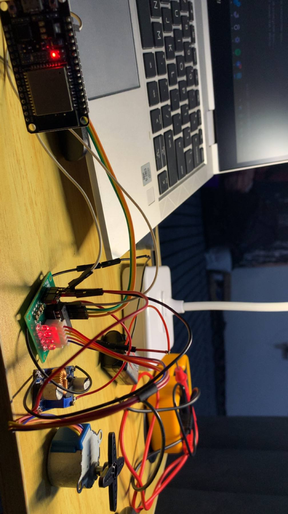
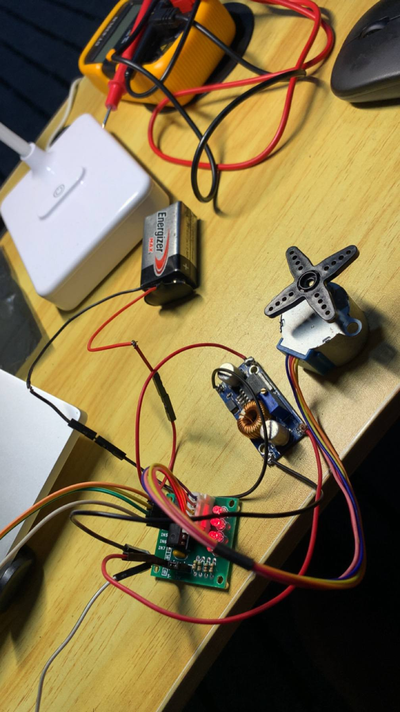
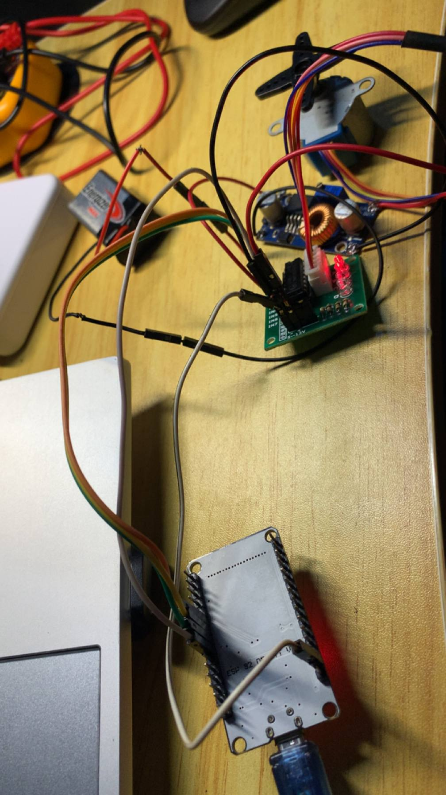

# ESP32 Stepper Motor Project with Buck Converter Power Regulation

A completed hardware project demonstrating how to control a stepper motor using an **ESP32**, safely powered by an external **9V battery** stepped down via an adjustable **DC-DC Buck Converter**.

By utilizing a switching buck converter instead of a traditional linear voltage regulator, this setup minimizes power wasted as heat and isolates high-current paths, keeping the ESP32 development board safe from current spikes.

## 🚀 Features
* **Safe Voltage Regulation:** Drops the 9V battery voltage down to a stable 5V rail for both the ESP32 and motor driver.
* **High Efficiency:** Employs a step-down buck converter to handle the current spikes of a stepper motor without overheating.
* **Precise Control:** Utilizes the Arduino `Stepper.h` library mapping directly to hardware GPIO control lines.

---

## 🛠️ Hardware Requirements
* **Microcontroller:** ESP32 Development Board
* **Power Source:** 9V Battery (measured stable at ~8.56V)
* **Voltage Regulator:** LM2596 DC-DC Buck Converter Step-Down Module
* **Motor Driver:** Stepper Motor Driver Module (e.g., ULN2003 / A4988)
* **Motor:** Stepper Motor (e.g., 28BYJ-48 or similar)
* **Interconnects:** Jumper Wires & Breadboard

---

## 🔌 Hardware Pin Mapping

### Signal Control Paths

| Motor Driver Signal | ESP32 Microcontroller GPIO |
| :--- | :--- |
| **IN1** | GPIO 19 |
| **IN2** | GPIO 18 |
| **IN3** | GPIO 5 |
| **IN4** | GPIO 17 |

### Power Paths
* **9V Battery (+)** ➡️ Buck Converter **IN+**
* **9V Battery (-)** ➡️ Buck Converter **IN-**
* **Buck Converter OUT+ (5V)** ➡️ Split to ESP32 **VIN/5V Pin** & Motor Driver **VCC**
* **Buck Converter OUT- (GND)** ➡️ Split to ESP32 **GND** & Motor Driver **GND** *(Common Ground)*

---

## 📸 Project Gallery
*Real-world images showcasing the hardware implementation and final operating physical project.*

### Hardware Overview

### Buck Converter Setup

### Motor Driver Module

### Wiring Details

